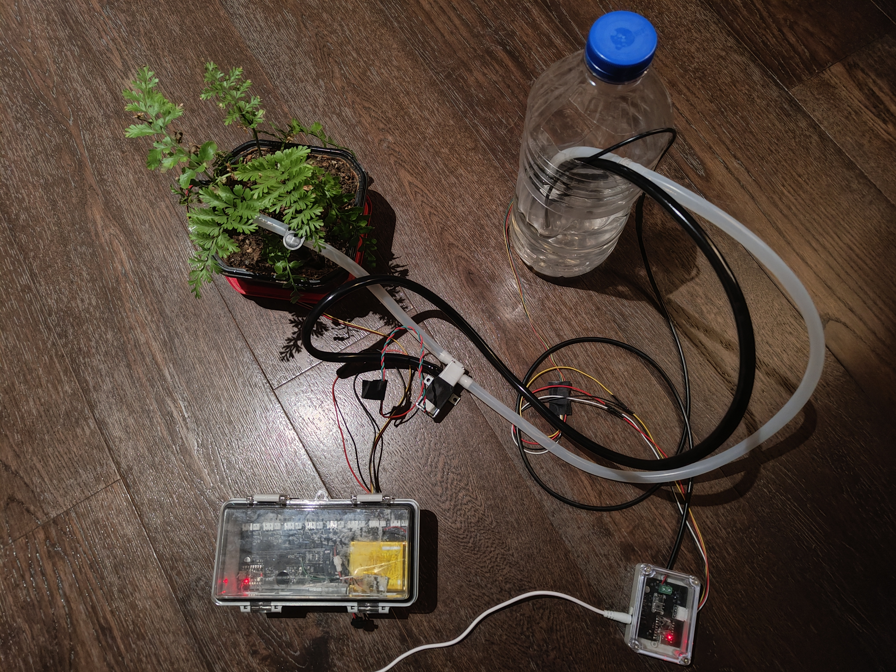
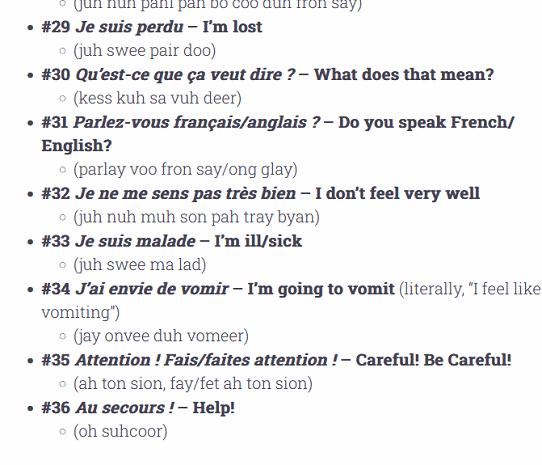

## Hi there 👋

## Featured projects

### [plant_watering](https://github.com/wangsiw1/plant_watering)

An ESP32-C3 automatic watering system with a central controller and wireless sensor workers. Monitors soil moisture and water levels, controls pumps and valves, and provides a web interface for configuring and monitoring watering.

- **Languages:** C, C++, Python, HTML, CSS, JavaScript.
- **Platform and frameworks:** ESP32-C3, Arduino, ESP-IDF, FreeRTOS.
- **Libraries and connectivity:** NimBLE, Bluetooth Low Energy, Wi-Fi, ArduinoJson.
- **Tools:** PlatformIO, KiCad.

### [translate-overlay](https://github.com/wangsiw1/translate-overlay)

A desktop tool that recognizes and translates text from images, videos, games, and other screen content, displaying translations over the original text. Runs OCR and translation models locally without an API key or dedicated GPU.

- **Language:** Python.
- **GUI and processing:** PySide6/Qt, ONNX Runtime, OpenCV, NumPy, Pillow, scikit-learn.
- **Models and tokenization:** CRAFT, Florence-2, MADLAD-400, Gemma 3/3n, SentencePiece, Hugging Face Tokenizers.
